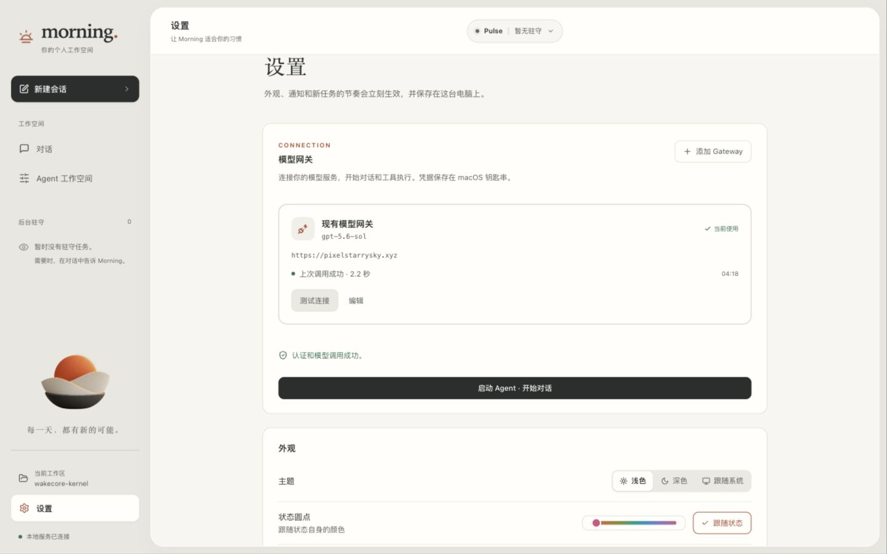
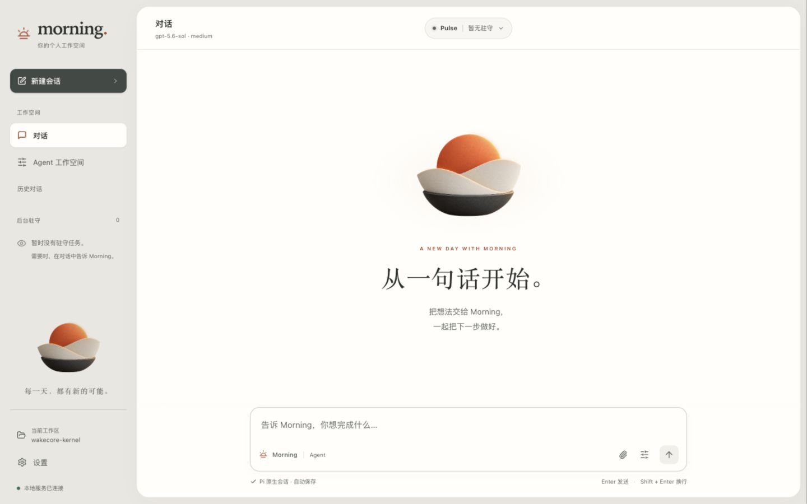

# Morning：Gateway 与 Pi 原生能力验收

日期：2026-10-11。环境：macOS arm64，Pi 0.99.1，现有 API Key 网关，实际模型 `gpt-5.6-sol`。

图形版本说明：本记录中的早期 Logo 动效已被后续的立体日出分层方案取代。现行图形、入口替换与动画验收见 [分层 Logo 规范](../design/morning/motion_spec.md)。

## 实现与保留的原生能力

| 项目 | 实现 | 原生能力与边界 |
| --- | --- | --- |
| Gateway | GUI 添加、修改、删除配置或凭据；选择默认连接；真实模型测试；认证、地址、协议、超时等错误反馈；重启恢复 | 使用 Pi ModelRuntime 与 CredentialStore，凭据保存在 macOS Keychain。模型结果返回后才记录连接成功 |
| Agent | 默认执行入口切换为 AgentSessionRuntime 与原生 runRpcMode | 不再使用前置驻守分类器、四工具白名单、内存会话替代品或自设 24 轮限制 |
| 会话 | 新建、继续、命名、复制、历史消息分支、会话树导航、JSONL 导入、HTML 导出与下载 | Pi SessionManager 是唯一会话来源。原 Morning 历史通过原生条目迁移，旧文件保留 |
| 执行 | 原生工具调用、流式结果、图片、思考内容、处理中补充指令、完成后再做、停止与恢复未执行的队列文字 | 接受 prompt 与任务完成分别处理。停止使用 clear_queue 与 abort，不等待整轮执行结束后再读取指令 |
| 模型与上下文 | 模型、思考深度、用量、自动与手动整理、重试和队列模式 | 能力继承 Pi 模型目录；未知模型使用 Pi 默认值。整理模型上下文不删除 GUI 中的原始历史 |
| Skills / 扩展 / MCP | 原生发现、工作区说明、模板、命令、工具选择、重载、诊断、包安装/更新/移除 | 使用 DefaultResourceLoader、原生信任解析与 DefaultPackageManager。MCP 沿用 Pi 工具注册与授权流程 |
| 扩展 GUI | 选择、确认、输入、多行编辑、通知、状态、文本组件、编辑器填充 | Pi RPC 不支持 TUI 自定义组件和原始终端输入；GUI 如实说明限制 |
| Pulse | 网页读取、计划准备与驻守控制作为 Pi 的增量工具 | 调度、授权、具体载荷审批和提交后核验继续由 WakeCore 负责 |
| Logo | 现有 SVG 分层入场、执行呼吸、悬停/按下反馈；主视觉短暂淡入 | 保持原始几何与最终姿态；遵循减少动态效果。附独立动效预览 |

## 真实链路

1. Gateway 经 GUI 成功测试；正式页面测试约 2.2 秒返回模型结果。
2. 通过完整 API 流程将真实凭据保存到 Keychain。第一次模型调用约 1.8 秒；替换为刻意无效的测试凭据后约 0.23 秒返回认证错误；恢复原凭据、重启后约 2.1 秒再次成功。
3. 删除凭据与配置后，钥匙串中的对应测试项消失，重启不重新导入。所有临时生命周期验收项均清理。
4. GUI 发起写入 `MORNING_ALPHA` → 原生 edit 改为 `MORNING_BETA` → read 读取 → bash 验证，最终实际回复 `MORNING_GUI_TOOLS_OK`。四个原生工具均执行。
5. 在 bash 已开始等待时点击停止；任务立即结束，等待之后的文件没有写入。
6. 工作区 Skill 被原生发现，经 GUI 执行后实际读文件，返回 `NATIVE_SKILL_OK MORNING_BETA`。
7. 自建验收扩展完成选择、确认、输入、多行编辑，并把结果和文本组件送回 GUI。该扩展仅位于独立临时工作区，未加入正式工作区。
8. 重启后恢复同一个会话，模板调用读取工作区说明并返回 `MORNING_CONTEXT_PRESENT` 和先前的文件内容。
9. 默认配置下短会话正确报告无需整理。在独立验收工作区把 Pi 原生 `keepRecentTokens` 设为 512 后，真实模型完成一次整理；GUI 保留整理前记录，之后不调用工具仍正确回答 `MORNING_BETA`。正式工作区的整理配置没有改动。
10. Agent 运行时从 GUI 加入“完成后再做”消息，出现 1 条排队状态；先返回 `BASE_DONE`，再独立返回 `FOLLOWUP_DONE`。

证据：[Gateway 生命周期](native-pi-20261011/gateway-lifecycle-live.json)、[Pi 实际会话结果](native-pi-20261011/native-gui-evidence.json)。

## 回归与视觉检查

- 全量非浏览器检查：736 通过，9 按环境条件跳过（最终代码复核，30.16 秒）。
- 浏览器检查：70 通过；最后的前端相关检查另跑 6 项全部通过。
- 原生 Pi 与凭据专项共 16 项，包含会话恢复/分支、真实终端中断、Skills/扩展交互、原生包管理、会话树、HTML 导出及下载访问控制；也覆盖 Agent 已启动时删除凭据、修改默认网关不覆盖用户原生模型选择。不调用模型的契约测试与上述真实网关验收明确分开。
- Node 检查：8 通过，其中 3 项为本次新增原生适配契约，5 项为保留的旧适配器回归。
- TypeScript 与前端构建、Ruff、OpenAPI 一致性、diff 格式检查通过；Pi 依赖审计未发现漏洞。
- 桌面 1440×900、手机 390×844 的布局和交互检查；关键页面通过 Axe 检查，无横向溢出。手机视觉证据采用独立浏览器测试截图，避免内嵌浏览器视口缩放影响截图。
- Logo 在 0/110/290/560/760/890 ms 的帧已检查，缓动计算样式符合非线性变化。静态终点与动画最终帧相差 0 像素，最终帧 IoU = 1.0。
- 按固定视觉量表的主观复核为 61.5 → 85.9 / 100；层次 +2.7、布局 +2.0、字体 +2.1、组件 +3.0、配色 +2.4、一致性 +2.1、响应式 +2.4、可用性 +3.1（各项满分 10）。这是渲染复核，不代表用户满意度；[评分与证据](native-pi-20261011/scorecard-final.json)独立于功能检查。长历史的显示密度仍可继续按使用偏好调整。

动效：[预览](../design/morning/logo_motion.html)、[设计说明](../design/morning/motion_spec.md)、[验证数据](native-pi-20261011/logo-motion-qa.json)。

## 仍需区分的限制

- 本次真实认证验收是用户指定的现有 API Key 网关，没有登录新的 OAuth 账户。Pi 原生提供方的认证交互已接入，其他服务仍需各自的账户验收。
- 系统凭据后端当前实现 macOS Keychain；Windows/Linux 未提供明文降级。
- Pi 的终端自定义组件、终端快捷键和 TUI 专属主题界面无法通过其 RPC 接口完整呈现。
- MCP 工具发现和调用保留原生机制；没有用用户的外部 MCP 服务器做端到端验收。`/mcp` 在 RPC 模式显示状态，登录/登出/重连使用它的原生命令。
- 浏览器驻守是增量扩展，本轮未在外部业务站点自动提交操作；不能据此宣称所有网站都无需适配。
- 原有密钥文件为兼容其他启动方式而保留；Morning 的新配置和修改写入钥匙串，删除配置后不会再从旧文件恢复。
- 默认采用 Pi 原生工具权限，旧适配器的 macOS 工作区沙箱不是当前运行时的安全边界。

所有修改目前留在本地工作区，未在本次工作中提交或推送。
